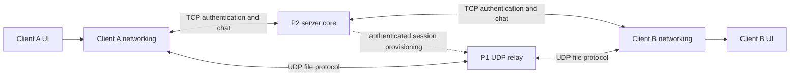
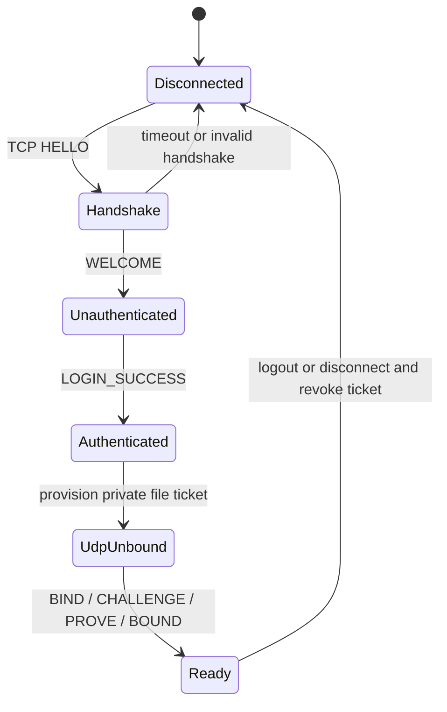
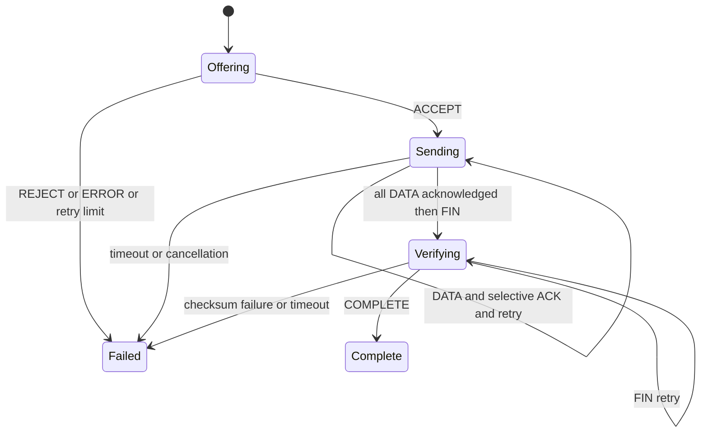
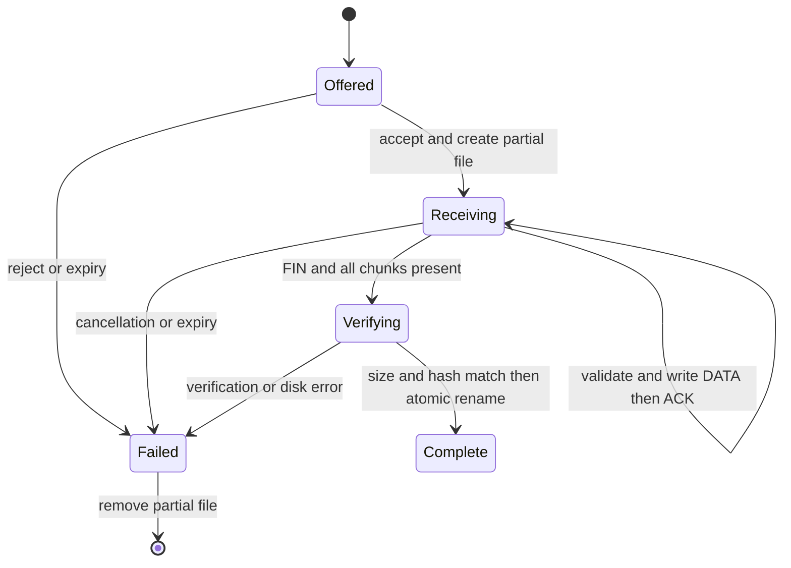
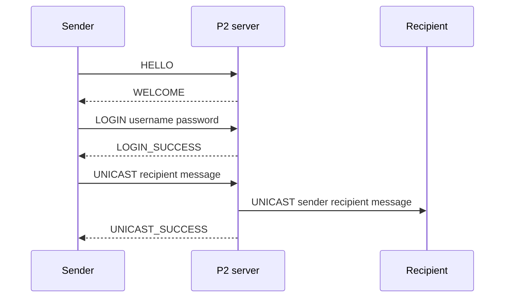
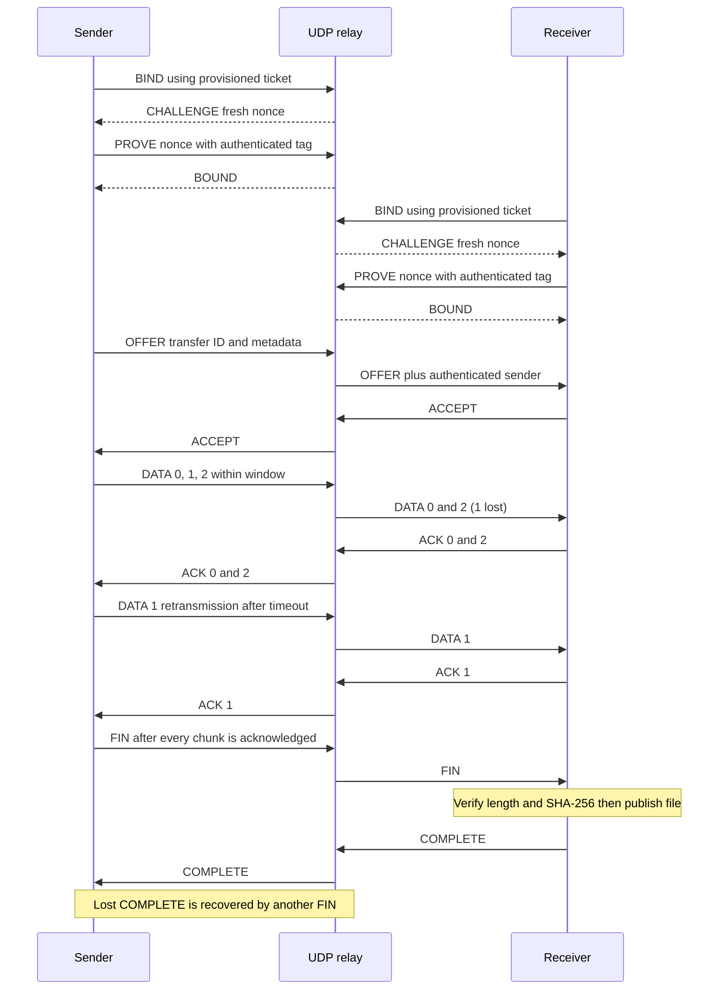

# P1 Protocol design and reliable UDP file transfer

P1 owns assignment steps 1 and 6. This specification is written before the P1
implementation. The branch starts at `main` and does not import P2 commits.
The file service runs independently and exposes session provisioning hooks for
P2 and an event queue for P3. It uses Python 3.9+ standard-library raw sockets.

## Architecture and ownership



The relay forwards bytes without storing file contents. File offers, acceptance,
chunks, acknowledgments, and verified completion all use UDP; reliable control
exchanges are implemented at the application layer. Thus P1 can be demonstrated
without duplicating P2's authentication server. In the demo, session tickets are
provisioned locally. They are not a replacement for the application's login.

P2 authenticates a user, calls `FileRelay.register_session(username)`, and sends
the returned private ticket and UDP relay address over its authenticated control
connection. P2 calls `unregister_session(username)` on logout/disconnect. A TCP
source port is never treated as a UDP endpoint. P3 constructs a `FileClient` with
the ticket, displays its events, and calls `accept_file`/`reject_file` for offers.

Network I/O, protocol validation, disk assembly, and UI are separate. Each client
has one UDP reader; sender operations can run on application worker threads.
Hash verification runs on a bounded worker pool. Transfers have independent IDs,
sequence spaces, windows, and files, so a missing file chunk does not stall chat
or a different transfer. Files are delivered in order on disk, not forced into a
single ordered stream shared with other traffic.

## Compatibility contract for the whole application

P2's reviewed branch uses a TCP `HELLO\n` / `WELCOME\n` handshake, followed by
UTF-8 JSON objects terminated by LF. Preserve this format during integration.
The following table records that existing contract, not code merged into P1.

| Direction | Request or event | Required fields |
|---|---|---|
| Client to server | `REGISTER`, `LOGIN` | `action`, `username`, `password` |
| Client to server | `UNICAST` | `action`, `recipient`, `message` |
| Client to server | `BROADCAST` | `action`, `message` |
| Client to server | `LIST_ONLINE` | `action` |
| Server to client | Operation response | `status` |
| Server to client | `UNICAST` event | `type`, `sender`, `recipient`, `message` |
| Server to client | `BROADCAST` event | `type`, `sender`, `message` |
| Server to client | Online list | `status=LIST_ONLINE_SUCCESS`, `users` |

P1 v1 specifies `FILE_SESSION` and TCP `PING` / `PONG` as the two P2 additions
needed for file session provisioning and keepalive. They require P2 integration;
P1 does not claim to implement them in P2. Existing chat
uses TCP; implementing the assignment's broader UDP messaging requirement is
outside the file-transfer module. `shared.protocol.encode_message` and
`decode_message` provide bounded JSON framing for future shared use.
Requests remain limited to 1024 bytes including LF, matching P2. The unified v1
response/event limit is 8192 bytes including LF to accommodate 20 Unicode user
names: use `encode_message(..., max_length=MAX_RESPONSE_LINE)` and
`decode_message(..., max_length=MAX_RESPONSE_LINE)` in the server-to-client
direction. P2 must enforce P1's username rule (1–64 UTF-8 bytes, no edge
whitespace or ASCII control characters) for this bounded profile; its current
authentication module accepts a wider set. The default helper limit remains
1024 bytes for backward-compatible client requests.

## TCP control contract

Default TCP port is 5000; default UDP relay port is 5001. Both are configurable.
After the plaintext handshake, each message is one UTF-8 JSON object followed
by LF (`0x0A`). Embedded newlines must be JSON-escaped. Buffer reads and extract
complete lines: one `recv` may return part of a message or multiple messages.
Requests use `action`, responses use `status`, and asynchronous chat events use
`type`. Codes are uppercase, case-sensitive application strings, not HTTP codes.

There are no request IDs in v1. Allow one outstanding TCP request per connection,
including keepalives. One reader separates `status` responses from `type` events;
events can arrive between responses. Serialize writes using MessageRouter's
existing per-client send lock. Passwords must be nonempty strings, with the
complete request still fitting 1024 bytes. UNICAST recipient and message, and
BROADCAST message, must be nonempty strings. Derive sender identity from login.

### Actions and statuses

Existing behavior was checked against P2 commit `fbf53eb`. Rows marked **new**
are the contract P2 needs to implement. Malformed JSON, missing/wrong field types,
or unsupported actions receive `INVALID_REQUEST`. Protected requests made before
login receive `AUTH_REQUIRED`.

| TCP action | Required extra fields | Success response | Other operation statuses |
|---|---|---|---|
| `REGISTER` | `username`, `password` | `REGISTER_SUCCESS` | `REGISTER_FAILED` for duplicate/invalid credentials |
| `LOGIN` | `username`, `password` | `LOGIN_SUCCESS` | `LOGIN_FAILED`, `ALREADY_LOGGED_IN`, `ALREADY_AUTHENTICATED` |
| `UNICAST` | `recipient`, `message` | `UNICAST_SUCCESS` | `UNICAST_FAILED` when recipient unavailable or send fails |
| `BROADCAST` | `message` | `BROADCAST_SUCCESS` | Common request/auth errors above |
| `LIST_ONLINE` | None | `LIST_ONLINE_SUCCESS` plus `users` array | Common request/auth errors above |
| `FILE_SESSION` **new** | None; login required | `FILE_SESSION_READY` plus `ticket`, `udp_port` | `FILE_SERVICE_UNAVAILABLE`, `FILE_SESSION_FAILED`, common request/auth errors |
| `PING` **new** | None; login required | `PONG` | Common request/auth errors above |

REGISTER creates credentials but does not log in. ALREADY_LOGGED_IN means the
username is active on another connection; ALREADY_AUTHENTICATED means this
connection already has a logged-in identity. LOGIN_FAILED also covers failure
to establish session/router state. UNKNOWN_ACTION exists only in P2's internal
auth helper: the dispatcher returns INVALID_REQUEST for unsupported actions.

The following are illustrative bodies, not live credentials; append LF to each
object on the wire. `type` events go to recipients and `status` replies return
to the requester.

```json
{"action":"REGISTER","username":"alice","password":"example-only"}
{"status":"REGISTER_SUCCESS"}
{"action":"LOGIN","username":"alice","password":"example-only"}
{"status":"LOGIN_SUCCESS"}
{"action":"UNICAST","recipient":"bob","message":"Hello"}
{"type":"UNICAST","sender":"alice","recipient":"bob","message":"Hello"}
{"status":"UNICAST_SUCCESS"}
{"action":"BROADCAST","message":"Hello everyone"}
{"type":"BROADCAST","sender":"alice","message":"Hello everyone"}
{"status":"BROADCAST_SUCCESS"}
{"action":"LIST_ONLINE"}
{"status":"LIST_ONLINE_SUCCESS","users":["alice","bob"]}
```

Broadcast excludes the sender. P2 currently reports BROADCAST_SUCCESS even when
zero recipients were reached. UNICAST_SUCCESS confirms socket send, not a read
receipt. LIST_ONLINE returns a sorted snapshot including the requesting user.

### Handshake authentication and file session

1. Connect TCP; send exactly `HELLO\n`; server replies `WELCOME\n`. Invalid or
   overlong handshake receives plaintext `ERROR\n` then close. Default deadline
   is five seconds. Timeout, capacity rejection, or disconnect may close the
   socket without a JSON error response.
2. Register if necessary, then log in. Only LOGIN_SUCCESS establishes an
   authenticated connection identity.
3. Send `{"action":"FILE_SESSION"}\n`. P2 uses `active_username`, not an
   identity supplied by the request. Return this success shape; uppercase
   placeholders are not actual UUIDs or secrets:

   ```json
   {"status":"FILE_SESSION_READY","ticket":{"username":"alice","session_id":"UUID-TEXT","key":"64-LOWERCASE-HEX-CHARACTERS"},"udp_port":5001}
   ```

   Session ID is canonical hyphenated UUID text; key is a 32-byte secret encoded
   as 64 lowercase hexadecimal characters. Send the ticket only to its owner.
   Return the actual bound UDP port; the client uses its TCP server's IPv4
   address as the relay host, not `0.0.0.0`.
4. Cache the ticket for that authenticated TCP session. Repeated FILE_SESSION
   requests return the same ticket; call register_session only once. No login:
   AUTH_REQUIRED. Relay unavailable: FILE_SERVICE_UNAVAILABLE. Capacity, invalid
   username, or provisioning failure: FILE_SESSION_FAILED. Failure responses
   contain only status, without tickets, secrets, or tracebacks.
5. Construct FileClient from the ticket and perform UDP
   `BIND -> CHALLENGE -> PROVE -> BOUND`. The relay requires a valid tag and fresh
   challenge proof before binding an endpoint. Rebinding cancels old active
   transfers rather than resuming them. Passwords are never sent over UDP.
6. Queue TCP `{"action":"PING"}` every 15 seconds; server replies
   `{"status":"PONG"}`. This keeps P2's 60-second request deadline alive.
   UDP PING/PONG is separate and cannot reset a TCP handler's timeout.
7. On TCP close/timeout, P2 calls unregister_session and clears its ticket cache.
   There is no TCP LOGOUT action in v1; close the connection to log out. Revoked
   tickets no longer authorize UDP traffic. A later login receives a fresh ticket.

P2 starts/stops one FileRelay, provisions/revokes sessions, and sends TCP replies
through MessageRouter's send lock. P1 carries **all** file OFFER/ACCEPT/DATA/ACK/
FIN/COMPLETE traffic over UDP: those packets are not TCP actions and do not pass
through MessageRouter. P3 drives FileClient, receiver acceptance, and UI events.
The P1 event queue contains local application events, not extra TCP messages.
See [integration.md](integration.md) for code examples and lifecycle hooks.

## Datagram layout version 1

All integers use network byte order, without native padding. Every datagram is
one complete packet. The header is `struct.Struct('!4sBB16s16sIH')` (44 bytes).

| Offset | Bytes | Field |
|---|---:|---|
| 0 | 4 | Magic `P1FT` |
| 4 | 1 | Version, exactly `1` |
| 5 | 1 | Message type below |
| 6 | 16 | Session UUID of the client on this relay hop |
| 22 | 16 | Transfer UUID; all zero for session messages |
| 38 | 4 | Zero-based chunk sequence; zero for control |
| 42 | 2 | Payload length, 0 through 1024 |
| 44 | N | Raw payload |
| 44 + N | 16 | First 16 bytes of HMAC-SHA256(header + payload, session key) |

Maximum application datagram size is **1084 bytes**, including header and tag;
file chunks carry up to **1024 bytes**. This conservative default reduces IP
fragmentation risk on ordinary LANs; it is not path-MTU discovery or a guarantee
for every VPN. Receivers reject truncation, trailing bytes, unsupported versions,
unknown types, invalid lengths, and invalid tags before processing file data.

The relay authenticates an inbound packet with the source session's 32-byte key,
checks its registered endpoint, role, and transfer state, then re-encodes it with
the destination session ID and key. A client accepts only its own session ID and
the configured relay endpoint. Session registration itself requires the valid
ticket. BIND from a new endpoint elicits a fresh random 16-byte CHALLENGE;
the client must return its nonce in an authenticated PROVE before BOUND is sent.
The challenge expires after five seconds. Replayed old proofs cannot move an
endpoint. Rebinding cancels any old active transfers; it does not resume them.

| Value | Type | Payload and meaning |
|---:|---|---|
| 1 | BIND | Empty; request UDP endpoint registration |
| 2 | BOUND | Empty; endpoint registration acknowledgment |
| 3 | OFFER | JSON metadata below; relay inserts authenticated `sender` |
| 4 | ACCEPT | Empty; recipient has allocated receive state |
| 5 | REJECT | UTF-8 reason, at most 256 bytes |
| 6 | DATA | Raw file bytes at offset `sequence * 1024` |
| 7 | ACK | Empty; receiver has written that DATA chunk |
| 8 | FIN | Empty; sender has acknowledgments for all chunks |
| 9 | COMPLETE | Empty; receiver verified length and SHA-256 and published file |
| 10 | ERROR | UTF-8 error code, at most 256 bytes |
| 11 | CANCEL | UTF-8 reason, at most 256 bytes |
| 12 | PING | Empty; session keepalive |
| 13 | PONG | Empty; keepalive acknowledgment |
| 14 | CHALLENGE | Fresh 16-byte relay nonce for a new UDP endpoint |
| 15 | PROVE | The 16-byte challenge nonce, authenticated with the session key |

ERROR payload codes currently used are `INVALID_METADATA`, `TRANSFER_ID_CONFLICT`,
`SELF_TRANSFER`, `RECIPIENT_OFFLINE`, `TRANSFER_LIMIT`, `PEER_DISCONNECTED`,
`ENDPOINT_CHANGED`, `TRANSFER_EXPIRED`, `DISK_ERROR`, `INTEGRITY_OR_DISK_ERROR`,
and `CANCELLED`. CANCEL may carry `CLIENT_CLOSED` or `SENDER_FAILED`. REJECT
defaults to `REJECTED`; REJECT/CANCEL also allow custom UTF-8 reasons within
256 bytes. Local deadline/retry failures raise TransferError and emit
`file_failed`; they are not additional TCP status codes.

OFFER fields: `recipient` (username), `filename` (basename, 1–128 UTF-8 bytes),
`size` (integer 0–268435456), `sha256` (64 lowercase hexadecimal characters),
`chunk_size` (1024), and `total_chunks` (`ceil(size / 1024)`). The relay adds
`sender` from the authenticated source, never trusts a supplied sender, and
rejects inconsistent sizes or chunk counts. Paths, separators, control
characters, `.` and `..` are invalid filenames. DATA's last chunk has exactly
the remaining file length; other chunks have exactly 1024 bytes. Empty files
have zero chunks and proceed directly from ACCEPT to FIN.

## Reliability and resource bounds

- BIND/CHALLENGE/PROVE/BOUND, OFFER/ACCEPT, and FIN/COMPLETE use retry with exponential backoff:
  initial RTO 1 second, cap 4 seconds, at most 8 retransmissions. Duplicate
  requests reproduce the same answer, without reallocating files.
- DATA uses selective repeat. ACKs identify individual written chunks; duplicate
  DATA is acknowledged again without a second write. Out-of-order DATA is
  written directly to its offset, tracked by a bounded bitmap.
- Initial congestion window is 4 chunks, maximum 32. Clean ACKs increase it
  gradually; timeout halves it and backs off the timer. RTT samples from
  retransmitted chunks are ignored. DATA is paced across a client's senders at
  no more than one packet every 2 ms by default. This is a small TCP-like AIMD
  design, **not BBR or CUBIC**. Those named algorithms need instructor scope
  clarification and are not claimed by this submission.
- A sender retains only its outstanding window in memory. Hashing and file I/O
  use bounded reads. The receiver bitmap is at most 256 KiB per file.
- Default limits: 256 MiB/file, 8 transfers/client, 64 active transfers/relay,
  20 registered sessions/relay, and 60 seconds of transfer inactivity. Terminal
  receipts are retained for 60 seconds, bounded to 256/relay and 128/client.
  The caller also supplies an overall send timeout (default 300 seconds).
- A sender succeeds only after COMPLETE. Missing ACKs cause selective retries;
  a missing COMPLETE causes FIN retry. The relay caches terminal outcomes so
  duplicates receive the same result even after a file is published.
- CANCEL is best effort; inactivity expiry bounds cleanup if it is lost. Socket
  errors, rejection, checksum failure, exhausted retries, expiry, or cancellation
  produce failure, remove partial files, and leave unrelated transfers running.
- Received files are staged in private unique subdirectories of the chosen
  download directory, then atomically renamed after verification. Existing files
  are not overwritten. The receiver never uses a sender-supplied directory.

## State diagrams



The TCP states above belong to P2; the UDP states below are implemented by P1.





## Sequence diagrams





## Security and assignment boundaries

HMAC authenticates UDP datagrams and detects modification; it does **not**
encrypt file contents. Whole-file SHA-256 detects incomplete or corrupt
reassembly, not a malicious authenticated sender. Step 8's payload encryption
and protected ticket delivery remain a separate integration responsibility.
Demo ticket files contain secrets and must stay local and ignored by Git.

The brief mixes TCP examples with UDP streaming, mentions BBR/CUBIC, and later
requests an HTTP/JavaScript UI while prohibiting high-level networking libraries.
This implementation meets the explicit step 6 UDP file-transfer requirement;
the team must clarify the remaining whole-application ambiguities with the
instructor. It does not claim completion of teammates' steps or LAN/device
acceptance from localhost tests.

## References

- Assignment 1 source document in this directory's parent.
- [IETF RFC 8085 sections 3.1–3.4](https://www.rfc-editor.org/rfc/rfc8085.html):
  UDP congestion, message-size, reliability, and checksum guidance.
- [Python struct byte ordering](https://docs.python.org/3/library/struct.html#byte-order-size-and-alignment):
  portable network byte order and explicit field sizes.
